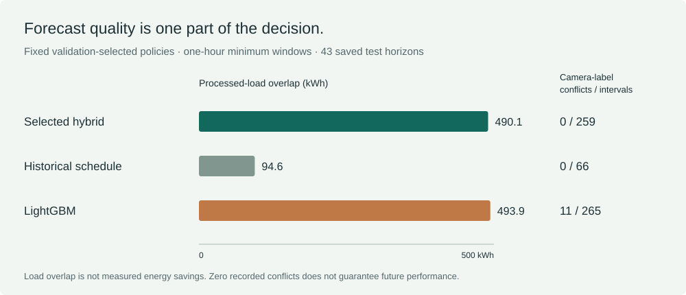

# Occupancy forecasting for building energy management

**First-author research study**

Junyu Chen · Chong Li | October, 2026

**Manuscript submitted to ACM BuildSys; decision pending.** Submission status reported by Junyu Chen on October 30, 2026.

[**Try the browser demo**](https://stevenchenjy.github.io/decision-aware-occupancy-forecasting/demo/) · [**Download the offline Python kit**](https://github.com/stevenchenjy/decision-aware-occupancy-forecasting/releases/tag/replay-kit-v1) · [**Run the notebook in Colab**](https://colab.research.google.com/github/stevenchenjy/decision-aware-occupancy-forecasting/blob/main/notebooks/try_the_study.ipynb) · [Report a reproduction](https://github.com/stevenchenjy/decision-aware-occupancy-forecasting/issues/new?template=reproduction.yml)



For researchers and students comparing occupancy forecasts with the recommendations they produce. The demo replays saved outputs in your browser. No installation, training, or building-data upload is required.

How can building-occupancy forecasts identify sustained empty periods worth investigating for changes to heating, cooling, and lighting schedules?

This study uses recorded data from LBNL Building 59 to connect that practical question with model development and evaluation. It compares historical schedules, machine-learning models, and a model blend, then checks whether their recommendations agree with recorded occupancy labels. The repository contains the paper, Python code, saved predictions, evaluation tables, and figures. The reported findings come from an offline analysis of saved model outputs.

[Project overview](https://stevenchenjy.github.io/decision-aware-occupancy-forecasting/) · [Worked example](https://stevenchenjy.github.io/decision-aware-occupancy-forecasting/guide/) · [Paper and citation](https://stevenchenjy.github.io/decision-aware-occupancy-forecasting/paper.html) · [Paper (PDF)](docs/occupancy-forecasting-working-paper.pdf) · [Code and results](#code-and-results) · [Reproduce the analysis](#reproduce-the-analysis)

## My role

I am Junyu Chen, the first author. I carried out the study design, data preparation, model development, evaluation, and manuscript writing, with guidance from Prof. Chong Li.

The code and saved outputs let readers inspect how the results were calculated, alongside the paper's explanation of the findings and their limits.

## Research approach

1. **Data preparation.** I worked with the cleaned LBNL Building 59 release at 15-minute resolution and documented the occupancy labels and the times at which input data become available.
2. **Model development and comparison.** I evaluated historical-average, tree-based, neural, and blended forecasts against the same recorded empty/occupied labels.
3. **Validation-based selection.** I used validation data to choose the blend weights and a score threshold. The decision rule requires a one-hour minimum window so the recommendations concern sustained empty periods.
4. **Held-out evaluation.** I measured forecast discrimination separately from the number of recommendations that later conflict with occupancy labels, and examined the processed building load associated with the recommendations.
5. **Analysis and writing.** I documented the findings in the manuscript, with result tables, uncertainty and selection-stability checks, figures, reproduction commands, and an audit of the conclusions.

## Main findings

The selected hybrid policy identified **14 empty windows containing 259 recommended 15-minute intervals** in the held-out policy analysis. All 259 intervals subsequently matched the recorded camera-empty labels, with **zero observed camera-label conflicts** in that evaluation period.

| Evaluation | Result |
|---|---|
| Forecast comparison | Across **388,032 overlapping test forecast rows from 4,042 anchors**, the selected hybrid has Empty-class AUPRC **0.8514**, compared with **0.8497** for Historical Average and **0.8382** for LightGBM. |
| Recommendation analysis | Across **43 non-overlapping policy horizons**, the fixed hybrid rule recommends **259 intervals** that form **14 windows**, all subsequently camera-label-empty. |
| Associated processed load | The hybrid recommendations coincide with **490.1 kWh** of processed HVAC-plus-lighting load proxy. LightGBM coincides with **493.9 kWh**, with **11/265 (4.15%)** camera-label conflicts. |

AUPRC summarizes how well a model distinguishes empty labels across score thresholds. The small point-estimate advantage of the hybrid does not establish statistical superiority: paired uncertainty intervals for the AUPRC comparisons cross zero. Zero observed conflicts describes this held-out period and does not guarantee future conflict-free recommendations.

These findings identify periods for further operational investigation. The kWh values are processed-load-proxy overlap, not measured energy savings or controllable capacity. Camera-empty labels do not verify physical absence. Testing the approach with verified source timestamps and actual building operations is a separate next step.

Read the [full results summary](RESULTS_SUMMARY.md), inspect the [forecast comparison table](results/canonical_model_comparison.csv) and [recommendation table](results/canonical_policy_10pct.csv), or review the [claims and limitations](CLAIMS_AND_LIMITATIONS.md).

## Code and results

| Resource | What to look for |
|---|---|
| [`src/`](src/) and [`scripts/`](scripts/) | Data preparation, forecasting methods, model selection, and analysis code. |
| [`results/`](results/) and [`predictions/`](predictions/) | Saved forecasts, canonical comparisons, recommendation accounting, timing documentation, and selection-stability results. |
| [`paper/manuscript/figures/`](paper/manuscript/figures/) | Figures used to explain the methods and results. |
| [Reproduction guide](REPRODUCING.md) | Supported inputs, commands, expected outputs, and the distinction between saved-output regeneration and empirical retraining. |
| [Final repository audit](reports/final_self_audit_2026-08-01.md) | The evidence boundary for interpreting the code, results, and paper. This audit supersedes earlier positive-integration wording where they conflict. |

The [project overview](https://stevenchenjy.github.io/decision-aware-occupancy-forecasting/) explains the study for a general reader. The [paper workspace](paper/README.md) provides the manuscript and methodology context.

## Reproduce the analysis

For a small download and standard Python, use the [offline replay kit](https://github.com/stevenchenjy/decision-aware-occupancy-forecasting/releases/tag/replay-kit-v1). Extract it and run `python replay.py --receipt reproduction-receipt.json --csv comparison.csv`. It recomputes the three reported policy rows without training dependencies, a Git checkout, or network access. The optional receipt stays on your computer until you choose to share it. This is the compact replay; the commands below regenerate the broader repository analysis.

The supported reproduction path reads the committed processed data and prediction files, then regenerates the downstream analysis. It does not retrain the forecasting models from original source streams.

Use a virtual environment and install the repository's requirements. Python 3.11 is the saved-output CI target; the requirements recommend Python 3.10-3.12. The recorded audit environment and reproduction paths are documented in [REPRODUCING.md](REPRODUCING.md).

```bash
python3 -m venv .venv
source .venv/bin/activate
python3 -m pip install -r requirements.txt
```

Run the following from the repository root. The commands write regenerated analysis and figure files to the working copy:

```bash
python3 -m pytest -q
python3 scripts/generate_hybrid_artifacts.py
python3 scripts/audit_validation_selection_stability.py
python3 scripts/run_decision_aware_joint_search.py
python3 scripts/run_window_aware_decision_search.py
python3 paper/scripts/generate_paper_figures.py
```

The external cleaned dataset is not needed for this saved-output path because the derived inputs are committed. [DATA.md](DATA.md) explains the source data and the separate legacy replay. `scripts/run_all.py` requires `--legacy-cleaned-replay` and writes to an isolated directory; it is not an empirical rerun entry point. The decision-aware and window-aware searches above are exploratory saved-output diagnostics, not newly confirmed primary findings.

## Evaluation details

<details>
<summary>Timing, model definitions, and sources of uncertainty</summary>

### When the inputs are available

The analysis uses completed 15-minute bins. A stored anchor labelled `t` is the left label of the completed input bin `[t, t+15 min)`, so the effective availability boundary is `t+15 min`. A policy horizon labelled `00:00` is therefore treated as available at `00:15`, with target bins through the next `00:15` exclusive.

This is a post-bin analysis of the cleaned LBNL release, rather than the original acquisition stream. Upstream imputation lineage and source timestamp semantics are unavailable. Row-order checks after import do not establish causal source availability or demonstrate that these inputs were available to an earlier operational forecast.

The forecast comparison uses 388,032 overlapping rows from 4,042 anchors. The policy accounting uses 43 non-overlapping midnight-labelled test horizons with the effective `00:15` boundary. These are different evaluation units.

### Model names and score interpretation

| Saved identifier | Description used in the paper |
|---|---|
| `Original Transformer` | Compact encoder-only Transformer with a known-future calendar projection. |
| `DLinear` | Direct linear occupancy-history baseline; this is not the decomposition-based DLinear architecture. |
| `Hybrid Seasonal-GBDT-Transformer` | The nominal validation-selected primary score blend: Historical **0.15** / LightGBM **0.60** / Transformer **0.25**. |

The threshold search maximizes the offline processed-load proxy subject to a **10% empirical validation interval-conflict cutoff** and a one-hour minimum window. The cutoff concerns observed validation intervals and is not a future-risk guarantee.

The stored outputs are bounded, uncalibrated Empty-class scores in `[0,1]`. Brier, log loss, and ECE are diagnostic measures here. The blend and threshold are nominal validation selections, not uniquely stable optima; see [the selection-stability results](results/validation_selection_stability.csv).

The deep-model runs carry labels 42, 43, and 44, but model construction preceded seed reset. Their ensemble is evidence from the saved outputs, rather than a controlled study of variation across initializations.

The offline load opportunity does not establish comfort preservation, controller performance, or generalization beyond this building and evaluation period. The [full results summary](RESULTS_SUMMARY.md) and [claims and limitations](CLAIMS_AND_LIMITATIONS.md) give the uncertainty and interpretation details.

</details>

## Empirical next step

A prospective evaluation requires source streams with observation-end timestamps and imputation lineage, a tested bin-end issue convention, corrected seed initialization before model construction, and a locked environment. The models then need to be retrained, selected using training and validation data, and evaluated once on a later untouched period or an independent building. A simulator or building intervention with equipment and comfort constraints is also needed before making energy or control claims. See the [rerun manifest](paper/audits/rerun_manifest.md).

## Manuscript and research history

The paper is **Validation-Selected Hybrid Occupancy Forecasting for Empty-Window Recommendations: An Offline Post-Bin Case Study**, by Junyu Chen and Chong Li.

The PDF is an unpublished author manuscript; this repository does not claim peer-review acceptance. The supplied PDF is preserved unchanged and still contains pending declaration and persistent-archive placeholders. The earlier anonymous LaTeX manuscript is a separate audit document. The [manuscript provenance note](paper/research-record/README.md) explains their relationship.

[Paper (PDF)](docs/occupancy-forecasting-working-paper.pdf) · [Citation / BibTeX](docs/citation.bib) · [Archived research snapshot](https://github.com/stevenchenjy/decision-aware-occupancy-forecasting/releases/tag/research-record-v1) · [Earlier anonymous manuscript](paper/manuscript/main.tex)

The [`docs/`](docs/) directory contains the public project page, supplied author manuscript, and citation. [`paper/research-record/`](paper/research-record/) records snapshot provenance and checksums. [`paper/`](paper/) holds the earlier manuscript source, figures, audits, and submission materials. Historical reports and exploratory analyses remain in [`reports/`](reports/); use the final audit and canonical result tables when interpreting earlier claims.

## Try it, contribute, and reuse the code

- [Browser demonstration](https://stevenchenjy.github.io/decision-aware-occupancy-forecasting/demo/): change a threshold or duration, inspect a recorded horizon, and download the current replay as CSV. Parameter changes are exploratory.
- [Notebook](notebooks/try_the_study.ipynb): recompute the three fixed policy rows from compact records using Python's standard library, with an optional plot.
- [Demo guide](DEMO.md): data provenance, source hashes, expected outputs, local checks, and interpretation.
- [Contribution guide](CONTRIBUTING.md): reproduction reports, starter tasks, and focused pull requests. Failed reproduction attempts are useful feedback too.

If the work is useful, a star helps you find it again. A reproduction report, correction, or documented reuse tells us more about how the work is being used.

Original software code and usage documentation are available under the [MIT license](LICENSE). The dataset, manuscripts, figures, and saved research exports retain their applicable source terms; see [LICENSING.md](LICENSING.md).
